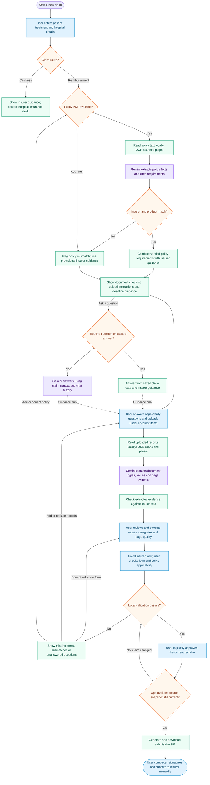

# ClaimWeave: current health-claim workflow

This diagram follows the current structured health-claim journey. The application
orchestrates the steps through preparation APIs; Gemini performs document extraction
and answers custom questions. Local rules build the checklist and validate the claim.
Human review and approval remain explicit.

Purple nodes use Gemini. Blue nodes involve user input or confirmation. Green
nodes represent application logic, local document tools, or displayed guidance.
Orange diamonds are decisions or checks.

## Implementation details

- **Planning precedes supporting-document analysis.**
  `POST /api/v1/claims/{id}/preparation/plan` reads only the optional policy.
  Without a policy, it builds a provisional insurer checklist without an extraction call.
  Requirements extracted from a mismatched policy are excluded.
- **Extraction uses a cache.** The Gemini extraction nodes run only for new or
  changed documents without a valid reusable extraction. Existing results reuse an
  owner-scoped cache; user corrections never transfer between claims.
- **Errors require recovery.** Unreadable or over-limit files remain blocking issues.
  If extraction fails, the user can retry explicitly; successful earlier batches stay
  cached. There is no automatic paid retry loop.
- **Chat assists but does not operate the claim.** Routine questions use local
  responses; custom questions require the configured Gemini key. Chat cannot upload,
  change claim data, approve a draft, or submit a claim.
- **Validation uses rules.** Checks include required documents, conditional answers,
  policy identity and applicability, field confirmations, name/date consistency,
  amounts, duplicates, bank details, and form acknowledgments. Saved corrections
  rerun checks without another Gemini call.
- **State is persisted.** PostgreSQL stores claim state, revisions, extraction
  metadata and user reviews. Documents remain in configured local storage.
  Uploads, edits and deletions invalidate earlier approval. Policy or intake changes
  also require the document plan to be refreshed.
- **Approval is preparation approval.** ZIP export rechecks the current revision
  and source snapshot. Signatures, hospital sections, insurer filing and the insurer's
  coverage decision remain outside automatic submission.

## Code map

| Responsibility | Source |
| --- | --- |
| Guided claim journey and uploads | `frontend/src/ClaimJourney.tsx` |
| Chat interface | `frontend/src/ClaimAssistant.tsx` |
| Document/form review and approval controls | `frontend/src/PreparationWorkspace.tsx` |
| Planning, analysis, reviews, approval and export APIs | `app/api/preparation.py` |
| Local document reading, quality checks and OCR | `app/documents.py` |
| Cached Gemini extraction and evidence grounding | `app/extraction.py` |
| Checklist construction, validation and revision invalidation | `app/preparation.py` |
| Local and Gemini chat responses | `app/health_chat.py` |
| Official form prefilling and submission ZIP generation | `app/forms.py`, `app/submission.py` |

Older claims without structured health intake still use the separate LangGraph
workflow in `app/agent/workflow.py`. That legacy graph includes claim classification
and a checkpointed human-review interrupt. It is not the execution engine for the
current guided health-claim journey shown above.
